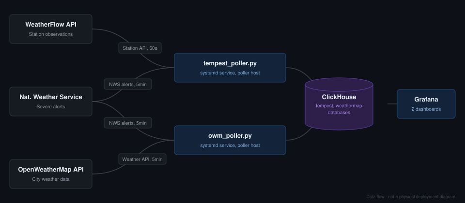
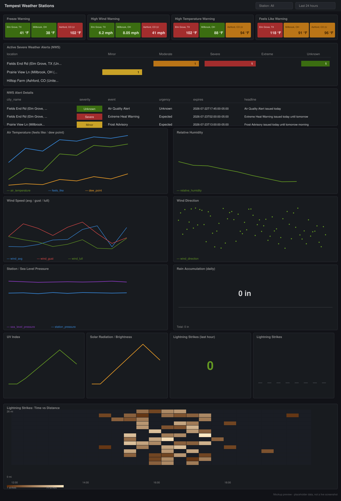
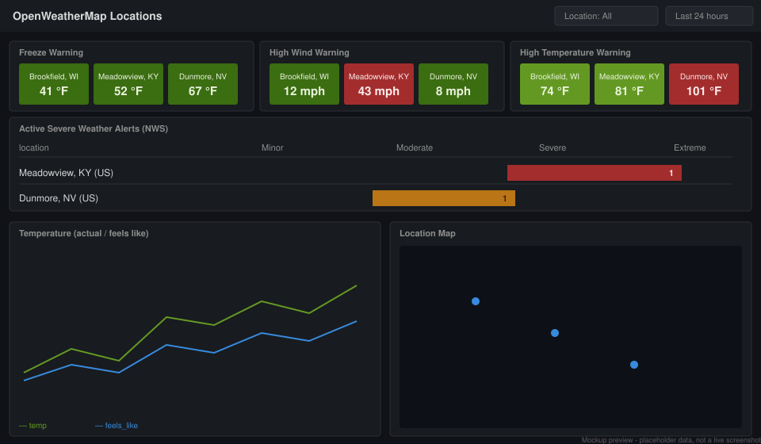

# Weather Monitoring Stack

Two independent data pipelines feeding a shared ClickHouse server and Grafana:

- **Tempest** — polls your own WeatherFlow Tempest station(s) directly
- **OpenWeatherMap** — polls current conditions for defined openweathermap locations

Both pipelines also independently check the National Weather Service for
active severe weather alerts at their respective locations.

> **Upgrading from the InfluxDB version?** The stack moved from InfluxDB/Flux
> to ClickHouse/SQL in v2.0 (Flux is in maintenance mode and unsupported in
> InfluxDB 3). [`MIGRATION.md`](MIGRATION.md) covers the cutover and copying
> your history across with the included migration tool.

See the [Releases page](https://github.com/davidlandry2019/weather-monitoring-stack/releases) for tagged versions.

## Architecture



This shows the data flow, not physical hosts — each poller independently
calls its own weather API plus NWS for alerts, and both write into the same
ClickHouse server under separate databases (`tempest`, `weathermap` - or one
shared database if you prefer), which Grafana queries with SQL to render its
dashboards.

- **NWS alerts are polled by both pollers independently**, each on its own
  5-minute cycle, rather than as a shared/deduplicated service.
- **Where things actually run**: the two pollers and ClickHouse can live on
  one host or be split across multiple; Grafana can be the same host or a
  separate one. This repo doesn't assume a specific physical layout —
  see `SETUP-TEMPEST.md` / `SETUP-OWM.md` for what each piece actually needs.

## Install

On the poller host (Debian/Ubuntu with systemd), as root:

```bash
git clone https://github.com/davidlandry2019/weather-monitoring-stack.git /opt/weather-monitoring-stack
bash /opt/weather-monitoring-stack/deploy/install.sh
```

The script installs Python and the dependencies, runs the tests, creates the
`weather-poller` service user, creates `tempest-poller.env` and `owm-poller.env`
in `/opt/weather-monitoring-stack`, and starts each poller once its env file is
filled in. **Update** later by running the same command: it pulls the latest
code first. Set up ClickHouse before the pollers; see the setup guides below.

## Recommended versions

- **OS**: Linux with systemd (Ubuntu/Debian recommended) for the poller hosts
- **Python**: 3.9+ for the pollers (the installer handles it)
- **ClickHouse**: any currently supported release (LTS recommended)
- **Grafana**: 10+ with the ClickHouse data source plugin (`grafana-clickhouse-datasource` v4+)

See `SETUP-TEMPEST.md` / `SETUP-OWM.md` for full system requirements.

## Dashboard previews

Mockups showing the general layout and styling — not live screenshots.
All location names, coordinates, and readings shown are fabricated
placeholder data.

**Tempest dashboard**


**OpenWeatherMap dashboard**


## Setup guides

- [`SETUP-TEMPEST.md`](SETUP-TEMPEST.md) — Tempest poller, ClickHouse install, and the Tempest Grafana dashboard
- [`SETUP-OWM.md`](SETUP-OWM.md) — OpenWeatherMap poller and its Grafana dashboard
- [`MIGRATION.md`](MIGRATION.md) — moving an existing InfluxDB install (and its history) to ClickHouse

## License

MIT — see [`LICENSE`](LICENSE).

## Support

If this project is useful to you, consider [buying me a coffee](https://paypal.me/DavidLandry2019).

## Files

| File | Purpose |
|---|---|
| `tempest_poller.py` | Polls WeatherFlow Tempest station(s) → ClickHouse |
| `tempest-poller.env.example` | Config template for the Tempest poller |
| `tempest_dashboard.json` | Grafana dashboard for Tempest data |
| `owm_poller.py` | Polls OpenWeatherMap for configured cities → ClickHouse |
| `owm-poller.env.example` | Config template for the OpenWeatherMap poller |
| `owm_dashboard.json` | Grafana dashboard for OpenWeatherMap data |
| `clickhouse_schema.py` | Shared ClickHouse table definitions; also a CLI to create/print the schema |
| `deploy/install.sh` | Installer/updater: clones or pulls, installs, tests, (re)starts the pollers |
| `deploy/tempest-poller.service`, `deploy/owm-poller.service` | systemd unit templates (installed by `install.sh`) |
| `requirements.txt` | Shared Python dependencies for both pollers |
| `migrate_influx_to_clickhouse.py` | One-off InfluxDB 2.x → ClickHouse history migration with row-by-row verification |
| `requirements-migrate.txt` | Extra dependency (`influxdb-client`) for the migration tool |
| `requirements-dev.txt` | Test dependencies (pytest + the migration tool's) |
| `tests/` | Unit tests (`pip install -r requirements-dev.txt && pytest`); `install.sh` runs them before every restart |
| `deployment-architecture.svg` | Architecture diagram (this README) |
| `tempest-dashboard-preview.svg` | Tempest dashboard mockup (this README) |
| `owm-dashboard-preview.svg` | OpenWeatherMap dashboard mockup (this README) |
